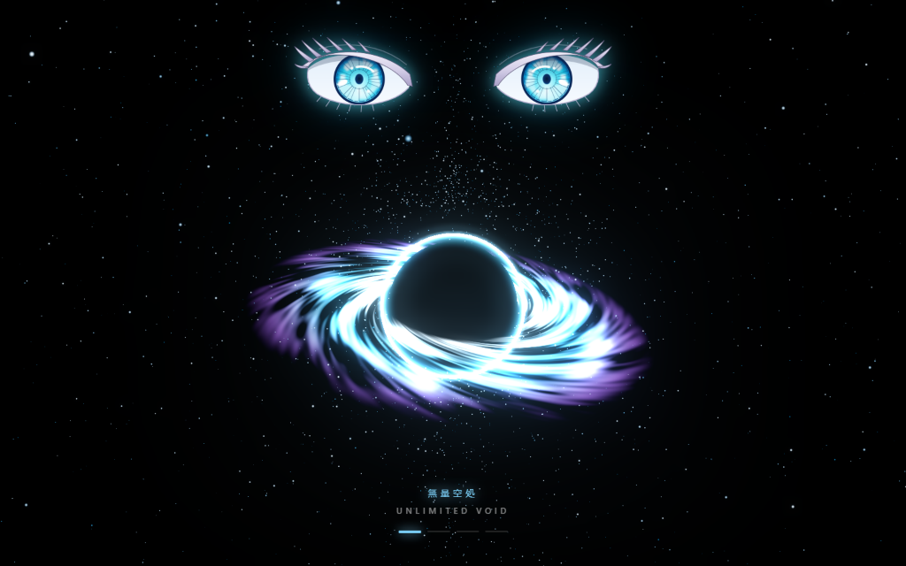
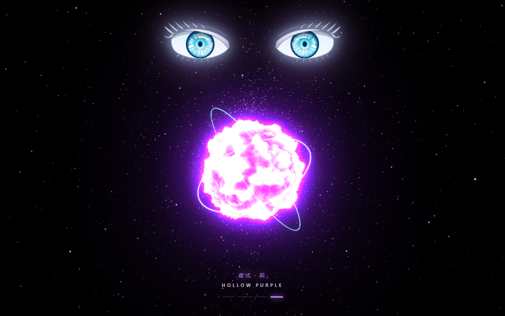

# Gojo Satoru — Unlimited Void & Hollow Purple (3D WebGL)

**Interactive 3D WebGL anime experience built with Three.js, Custom GLSL Shaders, HDR UnrealBloomPass, and 4,500 GPU-accelerated cursed-energy particles.**

---

## Preview

<table>
  <tr>
    <td align="center">
      
       
      <b>Stage I — 無量空処 · Unlimited Void (3D Black Hole + Accretion Disk)</b>
    </td>
    <td align="center">
      
       
      <b>Stage IV — 虚式・茈 · Hollow Purple (3D GLSL Plasma + HDR Bloom)</b>
    </td>
  </tr>
</table>

---

## Technique Sequence

| Stage | Technique | 3D WebGL Effect |
| :---: | :--- | :--- |
| **01** | **無量空処 · Unlimited Void** | 3D Event Horizon Black Hole, photon ring & swirling GLSL accretion disk |
| **02** | **術式順転・蒼 · Lapse: Blue** | Boiling 3D sapphire plasma singularity with FBM noise displacement |
| **03** | **術式反転・赫 · Reversal: Red** | Dual 3D Blue + Red plasma orbs facing off in a 4,500-particle field |
| **04** | **虚式・茈 · Hollow Purple** | Converging 3D crimson/blue collision erupting into a violet plasma core + 3D rings + HDR Bloom |

---

## Tech & Features

- **Three.js (ES Modules)** — Zero build step, runs natively on GitHub Pages.
- **Custom GLSL Shaders** — 3D Simplex FBM noise vertex displacement, Fresnel rim glow, and polar accretion disk vortex.
- **HDR Post-Processing** — `EffectComposer` + `UnrealBloomPass` + ACES Filmic Tone Mapping.
- **Interactive Controls** — Move mouse to parallax-orbit the 3D camera; click anywhere, press `Space` / arrow keys, or click the 4 minimal progress bars to switch techniques.

---

## License

MIT License
